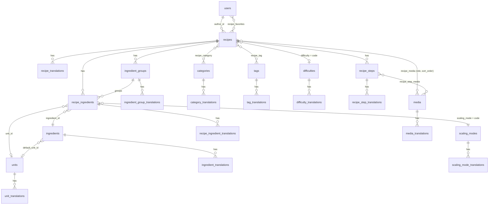

# The Sunday Table

A seasonal recipe website built with Laravel 13, Livewire 4, Filament 5, and PostgreSQL. Visitors can browse and search recipes without an account. Members can register, verify their email, log in, and keep a personal recipe box. Editors manage recipes through Filament at `/admin`.

## Requirements

- PHP 8.3 or newer with `ctype`, `curl`, `dom`, `fileinfo`, `filter`, `hash`, `intl`, `mbstring`, `openssl`, `pdo_pgsql`, `session`, `tokenizer`, `xml`, and `zip` extensions
- Composer 2.8 or newer
- Node.js 20.19+ or 22.12+ and npm
- PostgreSQL 14 or newer
- A mail provider for sending verification links in production

Filament requires the PHP `intl` and `zip` extensions. Laravel's PostgreSQL connection requires `pdo_pgsql`. Install these extensions for both CLI PHP and the PHP web runtime; do not bypass Composer platform checks in a deployed environment.

## Setup

1. Install PHP and PostgreSQL, then create an application database and user. For example, from `psql` as a database administrator:

	```sql
	CREATE USER sunday_table WITH PASSWORD 'replace-with-a-strong-password';
	CREATE DATABASE the_sunday_table OWNER sunday_table;
	```

2. Install PHP dependencies and create the local environment file:

	```sh
	composer install
	cp .env.example .env
	php artisan key:generate
	```

3. Edit `.env` and set `APP_URL`, `DB_HOST`, `DB_PORT`, `DB_DATABASE`, `DB_USERNAME`, and `DB_PASSWORD` for your PostgreSQL server. The example file uses PostgreSQL by default.

4. Configure email. The default `MAIL_MAILER=log` is for local development; verification messages are written to `storage/logs/laravel.log`. For real email verification, configure your SMTP provider in `.env`, for example:

	```dotenv
	MAIL_MAILER=smtp
	MAIL_HOST=smtp.example.com
	MAIL_PORT=587
	MAIL_USERNAME=your-mail-user
	MAIL_PASSWORD=your-mail-password
	MAIL_SCHEME=tls
	MAIL_FROM_ADDRESS=recipes@example.com
	MAIL_FROM_NAME="The Sunday Table"
	```

5. To seed the first administrator, set these values in `.env` before running the seeder. The seeded account is marked as verified and can access Filament.

	```dotenv
	ADMIN_NAME="Kitchen editor"
	ADMIN_EMAIL=editor@example.com
	ADMIN_PASSWORD=use-a-unique-strong-password
	```

6. Apply migrations, load the starter recipes and optional administrator, and install frontend dependencies:

	```sh
	php artisan migrate --seed
	npm install
	npm run build
	```

7. Start the website:

	```sh
	php artisan serve --host=0.0.0.0 --port=8000
	```

	Open `http://localhost:8000`. The editor sign-in is at `http://localhost:8000/admin`.

8. Publish uploaded media. Recipe images uploaded in Filament are stored on the `public` disk, so the public symlink must exist or images will not show on the site:

	```sh
	php artisan storage:link
	```

For live frontend development, run `npm run dev` in a second terminal and keep it open while using the Laravel server.

### Making an existing user an administrator

The seeder (step 5) is the easiest route. To promote a user who already exists:

```sh
php artisan tinker --execute 'App\Models\User::where("email", "you@example.com")->first()->forceFill(["role" => "admin", "email_verified_at" => now()])->save();'
```

Access to `/admin` requires a verified email and the role `admin` or `editor`. Roles live in `users.role` (`admin`, `editor`, `member`; default `member`):

| Role | Admin panel | Recipes | Lookup tables (categories, tags, difficulties, ingredients, units, scaling modes) |
| --- | --- | --- | --- |
| `admin` | yes | create, edit, delete, **publish**, archive | full control |
| `editor` | yes | create, edit, submit for review | read-only |
| `member` | no | none (can save recipes) | none |

Authorization is enforced by Laravel policies (`app/Policies`) for every Filament resource. `/admin` is registered by the Filament panel provider (`app/Providers/Filament/AdminPanelProvider.php`), so it does not appear in `routes/web.php`; use `php artisan route:list --path=admin` to see it.

### PHP extensions on a custom PHP build

If the admin shows `The "intl" PHP extension is required`, `intl` (and `zip`) is not enabled for the PHP binary running `artisan serve`. Install or enable it, then restart the server. Check with `php -m | grep -E 'intl|zip'`.

## Admin Panel

The Filament panel at `/admin` has a **Recipes** menu and a **Recipe data** group with one menu link per lookup table. Every lookup has English and Greek tabs for its translated fields, an active toggle and a sort order.

| Menu | Manages |
| --- | --- |
| Recipes | Recipes, translations, ingredients, steps, media, publishing |
| Categories | Recipe categories (`code`, names, localized slugs) |
| Tags | Recipe tags (`code`, names, localized slugs) |
| Difficulties | Difficulty levels offered on recipes (`Easy`, `Medium`, `A little project`) |
| Ingredients | Ingredient catalogue with plural names and a default unit |
| Units | Measurement units, type (mass/volume/count), base conversion and abbreviations |
| Scaling modes | How an ingredient line behaves when servings change (`linear`, `fixed`, `manual`) |

Notes:

- Recipe **introductions** use the Filament rich editor (bold, italic, lists, links, headings). The stored HTML is sanitised before it is rendered on the public recipe page; older plain-text introductions still display as paragraphs.
- Difficulties and scaling modes used to be hard-coded. They are now tables (`difficulties`, `scaling_modes`, with translation tables), and `recipes.difficulty` / `recipe_ingredients.scaling_mode` reference their `code` through foreign keys. The recipe form lists only active entries, plus the value a recipe already uses.
- A lookup record that is used by a recipe (a category, tag, difficulty, ingredient, unit or scaling mode) cannot be deleted; deactivate it instead. The delete action shows a notification explaining why.
- A lookup `code` cannot be changed for difficulties and scaling modes after creation.
- Only the `linear` scaling mode is scaled automatically by the serving calculator; other modes keep the written amount.

### Seeders

`php artisan db:seed` is idempotent (note: it resets the password of the `.env` administrator; run the individual seeders instead if you only want sample data) and runs, in order: `UnitSeeder`, `CategorySeeder`, `TagSeeder`, `DifficultySeeder`, `ScalingModeSeeder`, `IngredientSeeder`, `RecipeSeeder`, `RecipeContentSeeder`, plus the optional administrator from `.env`. Run an individual one with `php artisan db:seed --class=DifficultySeeder`.

## Using the Site

- `/` redirects to `/en`; `/en` and `/el` list published recipes. Search and category filters update with Livewire.
- `/en/recipes/{slug}` and `/el/recipes/{slug}` show the recipe in the selected locale, with matching localized slugs.
- `/register` creates a member account and sends a signed email-verification link.
- `/login` signs in an existing member. Unverified accounts are sent to the verification prompt before using member-only features.
- `/en/saved-recipes` and `/el/saved-recipes`, plus recipe saving, are available only to signed-in, verified members.
- `/admin` is the Filament recipe editor. Only verified users with the `admin` or `editor` role can access the panel.
- `/sitemap.xml` lists both home pages and both locale URLs for each published recipe.

Recipe photos are served from Unsplash URLs. Editors manage English and Greek titles, slugs, summaries, introductions, and SEO metadata in Filament. A recipe can be published only when both locales have a title and slug, and it appears publicly after it has a publication date. Other recipe data, including category, ingredients, and instructions, remains shared between locales.

Existing recipe copy is migrated as English and set back to draft until a Greek translation is added. The bundled starter recipes include both translations and are published when the database is seeded.

## Tests

Run the feature suite with:

```sh
php artisan test
```

Tests use the PostgreSQL database `the_sunday_table_test`, using the connection credentials from `.env`, and cover bilingual recipe discovery, locale-specific URLs, publication requirements, translation cleanup, registration, email verification, and verified-only recipe saving, and the Filament admin resources (including the lookup CRUDs and their delete protection). Filament page tests are skipped when the `intl` extension is missing. Create this test database with the same owner as the application database before running `php artisan test`.

## Database Structure

PostgreSQL. Translatable entities use a main table plus a `*_translations` table with one row per `locale` (`en` or `el`, enforced by a CHECK constraint). Lookup tables (`difficulties`, `scaling_modes`) are referenced by their `code`, not their `id`.



### Core tables

| Table | Key columns |
| --- | --- |
| `users` | `name`, `email`, `email_verified_at`, `password`, `role` (`admin`/`editor`/`member`) |
| `recipes` | `author_id` → users, `status`, `is_featured`, `published_at`, `deleted_at` (soft delete), `prep_minutes`, `cook_minutes`, `rest_minutes`, `base_servings`, `difficulty` → `difficulties.code` |
| `recipe_translations` | `recipe_id`, `locale`, `title`, `slug`, `summary`, `introduction` (rich-text HTML), `seo_title`, `seo_description` |
| `recipe_ingredients` | `recipe_id`, `ingredient_id`, `ingredient_group_id`, `quantity`, `quantity_max`, `unit_id`, `scaling_mode` → `scaling_modes.code`, `is_optional`, `sort_order` |
| `recipe_ingredient_translations` | `recipe_ingredient_id`, `locale`, `preparation_note`, `quantity_text` |
| `ingredient_groups` / `_translations` | Named sections of a recipe's ingredient list (`recipe_id`, `sort_order`; translated `name`) |
| `recipe_steps` | `recipe_id`, `step_number`, `duration_minutes` |
| `recipe_step_translations` | `recipe_step_id`, `locale`, `instruction` |
| `media` | `disk` (`public` or `remote`), `file_path` (uploads) or `url` (remote), `credit`, `credit_url`, `mime_type`, `file_size`, `width`, `height` |
| `media_translations` | `media_id`, `locale`, `alt_text`, `caption` |

The old `recipes.category`, `image_url`, `ingredients`, `instructions` and `servings` columns no longer exist: categories, media, ingredient lines, steps and `base_servings` are the only source of truth.

**Media.** Uploaded files (`disk=public`) and remote images (`disk=remote`, `url`, `credit`) share one model; `Media::publicUrl()` resolves either. A recipe has at most one `cover` (partial unique index on `recipe_media`). When no cover exists, or a remote image fails to load, the site shows `public/images/recipe-placeholder.svg`. Seeded recipes use Unsplash photos under the Unsplash licence; only add remote images you have the right to publish.

**Publishing.** Drafts may be incomplete. `RecipePublishingService::assertPublishable()` requires English and Greek title, slug and summary, at least one ingredient (with English and Greek names), steps in both languages, a category and a cover image. Only administrators can publish.

**Search.** `pg_trgm` and `unaccent` back GIN indexes on `f_unaccent(lower(...))` for recipe titles/summaries and ingredient, category and tag names, so Greek search ignores accents and case (e.g. `ΜΟΥΣΑΚΑΣ` finds `Μουσακάς`).

### Lookup tables (Recipe data menus)

| Table | Columns | Translated columns |
| --- | --- | --- |
| `categories` | `code`, `is_active`, `sort_order` | `name`, `slug`, `description` |
| `tags` | `code`, `is_active`, `sort_order` | `name`, `slug`, `description` |
| `difficulties` | `code` (≤20), `is_active`, `sort_order` | `name`, `description` |
| `scaling_modes` | `code` (≤20), `is_active`, `sort_order` | `name`, `description` |
| `ingredients` | `code`, `default_unit_id` → units, `is_active` | `name`, `plural_name`, `description` |
| `units` | `code`, `unit_type` (`mass`/`volume`/`count`), `base_conversion` (> 0), `allow_fraction`, `is_scalable`, `sort_order` | `name`, `abbreviation` |

### Pivot tables

| Table | Links |
| --- | --- |
| `recipe_category` | recipes ↔ categories (cascade on delete) |
| `recipe_tag` | recipes ↔ tags (cascade on delete) |
| `recipe_favorites` | users' saved recipes (composite primary key) |
| `recipe_media` | recipes ↔ media, with `role` and `sort_order` |
| `recipe_step_media` | recipe steps ↔ media, with `sort_order` |

### Framework tables

`cache`, `cache_locks`, `sessions`, `jobs`, `job_batches`, `failed_jobs`, `password_reset_tokens` and `migrations`.

### Delete rules

`recipe_ingredients.ingredient_id`/`unit_id`, `ingredients.default_unit_id`, `recipes.difficulty` and `recipe_ingredients.scaling_mode` use `RESTRICT`, so lookup records that are in use cannot be removed. The admin shows a message instead of failing.

## Production Notes

- Set `APP_ENV=production`, `APP_DEBUG=false`, a correct `APP_URL`, and a strong `APP_KEY`.
- Configure production PostgreSQL credentials, SMTP, HTTPS, and trusted proxy settings for your host.
- Build assets with `npm ci && npm run build`; serve the Laravel `public/` directory through a production web server.
- Run `php artisan migrate --force` during deployment. Keep `ADMIN_PASSWORD` out of source control and clear it after the first seeded administrator is created.
- Use Laravel's scheduler/queue worker if later features dispatch queued work; verification mail currently sends through the configured mail transport.
- The site emits canonical URLs, Open Graph metadata, responsive viewport markup, Recipe structured data, and a dynamic XML sitemap. Add the deployed sitemap URL to your search-console account after launch.

## Stack

- Laravel 13
- Livewire 4
- Filament 5
- PostgreSQL
- Vite
